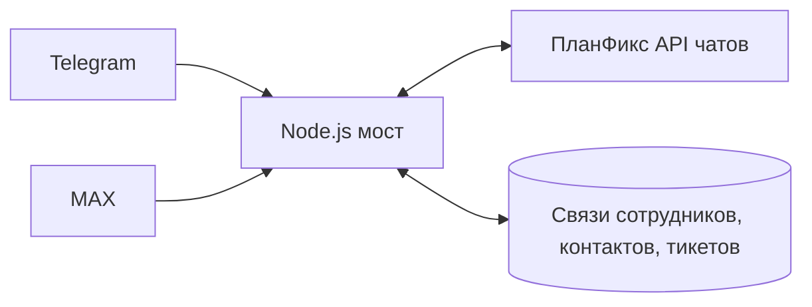

# Прототип моста ПланФикс ↔ Telegram / MAX

Небольшой сервер на Node.js по мотивам задачи интеграции CRM и мессенджеров. Он показывает **маршрутизацию и модель данных**, а не утверждает, что уже подключён к рабочим аккаунтам заказчика.



## Что уже работает

- Привязка сотрудника и контакта к идентификаторам ПланФикса, Telegram и MAX.
- Создание отдельной связи группы с тикетом; закрытие тикета исключает дальнейшую маршрутизацию группы.
- Сообщение от известного контакта попадает в нужный чат ПланФикса; сообщения посторонних игнорируются.
- Ответ из ПланФикса по `cmd=newMessage` направляется в соответствующий тестовый адаптер мессенджера.
- Повтор одного и того же сообщения не отправляется второй раз; поддержаны сообщения, редакции, реакции, цитаты и метаданные вложений.
- Входящий webhook ПланФикса принимает `application/x-www-form-urlencoded`, как указано в документации.
- Демонстрационный JSON-файл хранит связи, историю и ключи идемпотентности между запусками.

## Быстрый запуск

Требуется Node.js 20 или новее. Внешние пакеты и ключи для демо не нужны.

```powershell
npm run demo
npm test
npm start
```

`npm run demo` создаёт сотрудника, контакт и тикет, проводит входящее сообщение и ответ из CRM, затем показывает, что сообщение постороннего пользователя проигнорировано.

HTTP-сервис слушает только `127.0.0.1:4177`:

| Метод и путь | Назначение |
|---|---|
| `POST /demo/employees` | сотрудник |
| `POST /demo/contacts` | привязка контакта |
| `POST /demo/tickets` | группа для тикета в тестовом адаптере |
| `POST /demo/messenger-events` | входящее событие мессенджера |
| `POST /webhooks/planfix` | ответ ПланФикса, `cmd=newMessage` |
| `GET /state` | состояние демонстрации |

Пример запроса к серверу:

```powershell
$body = @{ crmUserId='1'; email='employee@example.test'; telegramUserId='tg-1' } | ConvertTo-Json
Invoke-RestMethod http://127.0.0.1:4177/demo/employees -Method Post -ContentType 'application/json' -Body $body
```

## Подключение к рабочим системам

Транспорт к API чатов ПланФикса предусмотрен: `PLANFIX_WEBCHAT_URL`, `PLANFIX_TOKEN`, `PLANFIX_PROVIDER_ID`. По умолчанию он выполняет **только симуляцию** и ничего не отправляет наружу. Реальный адрес и токен не должны попадать в GitHub. Для приёма запросов есть `PLANFIX_INBOUND_TOKEN`. При публикации обязательно понадобятся HTTPS, аутентификация всех служебных маршрутов, очередь с повторными попытками и надёжная БД вместо JSON-файла.

**Открытые вопросы по ТЗ:** публичная документация API чатов ПланФикса описывает сообщения и контакты, но не команды создания/закрытия тикета и управления группой. Для Telegram при работе именно от имени сотрудников нужен согласованный клиентский API и разрешённые сессии. Официальный бот API MAX описывает действия бота в уже доступных ему группах; возможность автоматически создавать группы и читать личную переписку рабочих профилей нужно подтвердить на тестовых аккаунтах. Поэтому эти действия остаются тестовыми адаптерами до проверки доступов и интерфейсов.

Источники: [API чатов ПланФикса](https://planfix.ru/help/API_для_чатов), [команды API](https://planfix.ru/help/Список_команд_API_для_чатов), [MAX: бот в группах](https://dev.max.ru/docs-api/use-cases/bot-in-chats-and-channels).
